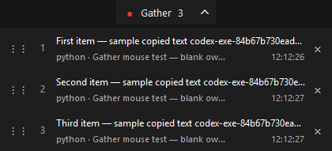
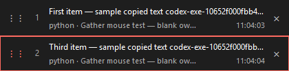
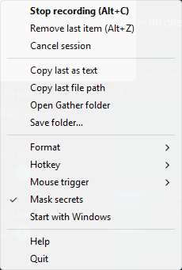

# Gather

Gather collects text you copy from any app into one file on your clipboard.

**Windows only.** Tested on Windows 11, x64. Windows 10 is untested.

Press **Alt+C** to start, then copy text from your browser, editor, chat or terminal.
Press Alt+C again to save the collected text as one file and put that file on the
clipboard. Paste it into a folder or an app that accepts file attachments, without
assembling the copies in a separate document.








## Install

1. Download **[Gather.exe from the latest release](https://github.com/aarahman04/gather/releases/latest)**.
2. Double-click it. There is no installer and no administrator access is required.
3. Look for the grey Gather icon in the tray, possibly under the hidden-icons arrow.
   Right-click it for settings; **Start with Windows** is optional.

## Windows SmartScreen warning

Gather.exe is **not code-signed yet**. Windows may show **Windows protected your PC**
or **Unknown publisher**. After checking the download, choose **More info**, then
**Run anyway**, if that option is available. Code signing is being pursued.

Download `Gather.exe.sha256` from the same release and compare it with:

```powershell
Get-FileHash .\Gather.exe -Algorithm SHA256
```

The hash must match the value in the checksum file. This confirms which file you
downloaded; it does not guarantee that software is safe. The code is open, and
[the release workflow](.github/workflows/release.yml) builds the EXE with GitHub
Actions from the tagged code in this repository. You can also
[build from source](#build-from-source).

## Usage

| Action | Hotkey or trigger |
|---|---|
| Start / stop | **Alt+C**, **middle-click**, or left-click the tray icon |
| Undo the latest remaining copy | **Alt+Z** while recording, or **Remove last item** in the tray; no redo |
| View or arrange items | Click the pill's arrow; drag a left handle to reorder, or click **×** to remove |
| Change the keyboard trigger | Tray → **Hotkey**: Alt+C, Win+Y, Pause, Scroll Lock or Ctrl+Alt+G |
| Change the mouse trigger | Tray → **Mouse trigger**: Middle-click, Alt + middle-click or Off |
| Choose where exports go | Tray → **Save folder…**; selection is remembered |
| Discard the current session | Tray → **Cancel session** |

Choose **Markdown (.md)**, **Word (.docx)** or **PDF (.pdf)** under **Format**.
Files default to your Windows **Documents\Gather** folder. Use **Save folder…** to
choose another folder; it applies to future exports. **Open Gather folder**
opens it. Each item includes its source app, window title and capture time.
Non-text copies and consecutive duplicates are ignored.

After stopping, **Ctrl+V** pastes the file into Explorer or attaches it in apps
that accept clipboard files. Terminals generally paste its path instead;
**Copy last as text** copies the collected text. Large exports show **Saving…**.

## Privacy

Gather runs locally, keeps collected text on your machine, and writes files to
your chosen save folder. It records copied text, source app, window title and time.
Gather makes no network connections for text collection or exports to a local
folder; checked on Windows 11 with Markdown, Word and PDF sessions.
**Mask secrets** is on by default, but only recognizes certain key patterns;
check exported files before sharing them. List previews always mask recognized keys.

Settings are in `%APPDATA%\Gather\config.json`. During recording, the crash-recovery
journal in `%APPDATA%\Gather\unsaved` stores **raw, unmasked text and metadata**,
including copies subsequently removed from the list. Journals are deleted after
a successful export or cancellation; after a crash or failed save, they remain
until recovery succeeds. There is no time-based expiry. To discard them, quit
Gather and delete that folder. Saved exports remain until you delete them.
If your save folder or AppData is synced, redirected or on a network share, Windows
or your storage provider may transfer those files elsewhere.

## Troubleshooting

- **Hotkey already in use:** pick another under **Hotkey**, or left-click the tray.
- **Middle-click changed:** the default replaces normal middle-click throughout
  Windows. Choose **Alt + middle-click** or **Off** under **Mouse trigger** to
  restore normal middle-click behavior.
- **Terminal text is not collected:** in Windows Terminal, select text then use
  **Ctrl+Shift+C** or right-click. In Claude Code's own mouse-selection mode,
  selection copies automatically; hold **Shift** while dragging to use the
  terminal's selection instead. In classic PowerShell or cmd, select text then
  press **Enter**. Ctrl+C without a selection may interrupt the running program.
- **Antivirus alert:** unsigned utilities with global input hooks can be flagged.
  Verify the release hash and report the detection with your Gather version.
  If you are unsure, leave it blocked or build from source. Do not disable protection.

## Build from source

Use **Python 3.12.7, x64**, on Windows. Quit any running Gather instance first;
the full tests use the clipboard and send keyboard/mouse input. They restore
clipboard text, but do not preserve images, file lists or other clipboard formats.
Keep the mouse and keyboard idle during desktop tests.

```powershell
git clone https://github.com/aarahman04/gather.git
cd gather
python -m venv .venv
.\.venv\Scripts\python -m pip install -r requirements-dev.txt
.\.venv\Scripts\pythonw -m gather
```

Quit Gather, then test and build:

```powershell
.\.venv\Scripts\python -m pytest -q
.\build.ps1
```

The build script also runs tests and produces `dist\Gather.exe`. Without an
interactive desktop, use `pytest -q --no-desktop` (with the venv Python) and
`build.ps1 -NoDesktop`. [Development notes](docs/development/README.md) describe
the skipped tests. Dependencies and LGPL source downloads are pinned in the repo.

## License and bugs

Gather is [MIT licensed](LICENSE). Bundled libraries retain their own
[licenses and replacement instructions](THIRD_PARTY_NOTICES.md).
[Report bugs](https://github.com/aarahman04/gather/issues/new/choose) with your
Gather version, Windows version, source app or terminal, and steps to reproduce.
For vulnerabilities, use [private security reporting](SECURITY.md).
